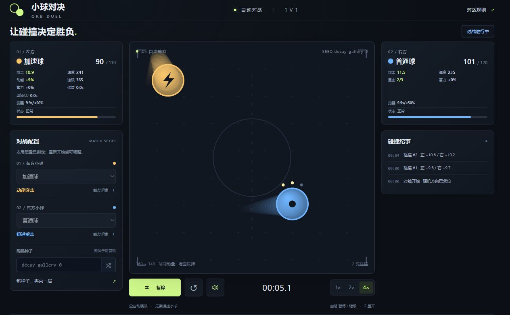
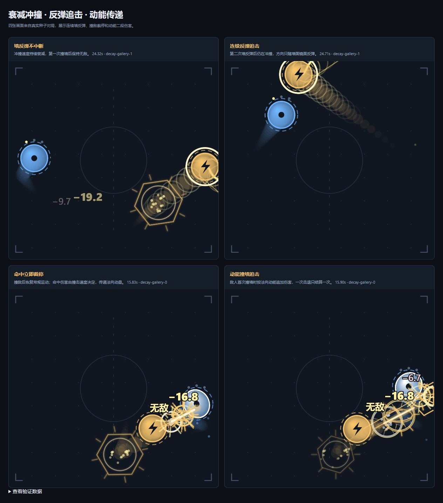

# ORB DUEL — Automatic Orb Battle Simulator

A personal browser game for watching automatic 1v1 battles. Pick two orbs, start a match, and watch their movement, collisions, abilities, and awakenings decide the winner.

Author: Shenghao Ye. Developed with extensive AI assistance through Codex, including implementation, iterative mechanics design, balance simulations, testing, and documentation, guided by the author's design direction and feedback.

[中文说明](README.zh-CN.md)

## Gameplay preview



An actual browser screenshot of the current version. The interface is in Simplified Chinese; this README provides an English overview and setup guide.

## Features

- Ten orb types, including mirror matches, with distinct melee, ranged, defensive, and area-control mechanics.
- Automatic movement in a compact rectangular arena. Walls reflect motion; orb collisions exchange momentum along the contact normal.
- One awakening per orb after **15 simulation seconds or at 50% health or below**, whichever happens first.
- Health bars, attack and speed values, ability resources, cooldowns, status effects, battle time, and a winner or draw result.
- Pause/resume, full reset, reproducible random seeds, and 1× / 2× / 4× simulation speed.
- Distinct wall and orb collision sounds, synthesized skill audio, particles, impact flashes, trails, and stronger awakening feedback.
- A responsive dark layout with stable status slots and an arena that keeps its size when a battle ends.
- Fully local gameplay: no account, network connection, backend, installation, or build step required.

## Orb roster

| Orb | Combat identity | Awakening |
| --- | --- | --- |
| Normal | Balanced melee fighter; successful hits build a heavy strike, while missed opportunities build a capped damage bonus. | Heals up to 8 HP and gains permanent collision damage. |
| Vampire | Restores 44% of actual attack damage dealt to health. | Periodic blood tether drains an enemy within range; a short connection refunds part of its cooldown. |
| Accelerator | Builds cruise speed; strong impacts knock enemies back and can cause a follow-up wall hit. | Telegraphs an invulnerable dash with continuously decaying speed. It can ricochet off several walls, ends on enemy contact, and transfers momentum for a speed-dependent wall follow-up. |
| Reflector | Periodic defensive stances return a portion of actual health damage taken. | Longer stances store damage and release a counter projectile; reflected damage cannot recurse. |
| Shield | Gains a temporary shield periodically, leaving openings between shield windows. | Stronger shielding and a small counter wave after a shield breaks. |
| Ranger | Predictive shots can bounce once; bullets can disarm enemy traps. | Fires a three-shot fan more frequently. |
| Trapper | Places mines that arm after a delay and expire after a limited lifetime. | Larger mines create chain explosions. |
| Boomerang | Throws a curved outbound-and-returning blade. Outbound hits mark enemies, returning hits consume the mark, and a complete catch empowers melee. | Throws two curved blades, with a reward for recovering both. |
| Laser | Locks a predicted direction, telegraphs, then fires a beam; beams can disarm traps. | Wider, stronger beams with a shorter cycle. |
| Venom | Melee hits and poison pools build up to three poison stacks; full stacks can be consumed for a detonation. | Enhanced poison pools can also trigger detonations, sharing the melee detonation cooldown. |



Detailed numbers, recovery rules, and interactions are documented in the [Chinese guide](README.zh-CN.md). Balance is preliminary and preserves distinct matchups rather than guaranteeing a 50% win rate for every pairing.

## Run locally

1. Use **Code → Download ZIP** on GitHub and extract the entire archive, or clone this repository.
2. Open the extracted project folder, usually `orb-duel-main`.
3. Double-click **`index.html`** and open it in a modern Edge, Chrome, or Firefox browser.

Keep the folder structure intact. Node.js and Python are **not needed to play**. Sound starts after interacting with the page, subject to the browser's audio policy.

For an optional local server, run this from the project folder if Python is installed:

```sh
python -m http.server 8799
```

Then open [http://127.0.0.1:8799/](http://127.0.0.1:8799/). Some browser test pages need this same-origin HTTP setup.

### Controls

| Control | Action |
| --- | --- |
| Left/right selectors | Choose orb types before a match. |
| Main button / Space | Start, pause, or resume. Space works when a form control does not have focus. |
| Reset button / R | Reset all state with the same seed. |
| New-seed action | Generate a fresh seed and start another match. |
| 1× / 2× / 4× | Change the rate of simulation time. |
| Speaker button | Toggle sound. |

Configuration is locked during a match. Opening the rules or switching to a background tab pauses the game.

## Simulation rules

Physics and combat use a fixed **1/240-second timestep**. Rendering rate does not change the rules, and speed controls advance simulation time. Collision separation and contact cooldowns prevent repeated damage from a single touch. Pausing freezes movement, skills, damage, entities, and effects; ending a match freezes combat.

Attacks in the same step resolve together: shields absorb damage first, health damage is allocated fairly, reflection happens once, and surviving vampires heal afterward. Simultaneous deaths produce a draw. Most impact and projectile damage varies by a seeded ±20%; tether and poison ticks use fixed damage. The same orb choices and seed reproduce a match within this version; rule updates may change old results.

There is no trajectory correction after a long collision drought. Late-match damage increases from 60 seconds; unavoidable health loss begins at 150 seconds to end exceptional stalemates without steering the orbs.

## Project structure

Plain HTML, CSS, and JavaScript, using Canvas 2D and Web Audio. There are no runtime packages or generated bundles.

| File | Responsibility |
| --- | --- |
| `index.html`, `styles.css` | Interface, controls, and responsive layout. |
| `js/config.js` | Orb definitions, constants, and seeded randomness. |
| `js/physics.js` | Movement, wall reflection, momentum exchange, and separation. |
| `js/skills.js` | Skill hooks and simultaneous damage resolution. |
| `js/world.js` | Projectiles, blades, beams, traps, and poison pools. |
| `js/characters.js` | Poison, impact, and curved-blade resource loops. |
| `js/awakening.js` | Awakening triggers and empowered abilities. |
| `js/engine.js` | Fixed stepping, lifecycle, simulation clock, and effect events. |
| `js/audio.js`, `js/spectacle.js` | Synthesized audio and ability feedback. |
| `js/renderer.js`, `js/app.js` | Canvas rendering, UI updates, and animation loop. |
| `tests/` | Logic checks, browser checks, and recorded reports. |

The current mode is 1v1 only. New orb types can reuse the existing configuration and skill modules without replacing the physics engine.

## Development checks

These checks require Node.js, but use built-in modules and need no package installation. Run them from the project folder:

```sh
node tests/verify-dash.cjs
node tests/verify-characters.cjs
node tests/verify-awakening.cjs
node tests/verify-recovery.cjs
node tests/verify-world.cjs
node tests/verify-mechanics.cjs
```

For broader simulation checks, use `node tests/verify-engine.cjs`; audio and visual isolation checks are in `verify-feedback.cjs` and `verify-spectacle.cjs`. `measure-balance.cjs` generates balance samples. The full simulation checks are more expensive than the focused checks above.

Browser checks include `tests/theatre-ui.html`, `tests/compact-ui.html`, and `tests/status-stability.html` for layout and interaction, plus `tests/dash.html`, `tests/characters.html`, and `tests/audio.html` for skill frames and sound.

The checked-in [validation record](VALIDATION.md) describes the current version's earlier test runs: 4,000 engine matches, 8,000 balance matches across acceptance and holdout seeds, 945 dash checks, and arena stability checks at 11 viewport sizes. The engine matches overlap the balance acceptance set; these counts do not represent 12,000 independent matches. These are recorded results, not a claim that every check was rerun during repository publication.
